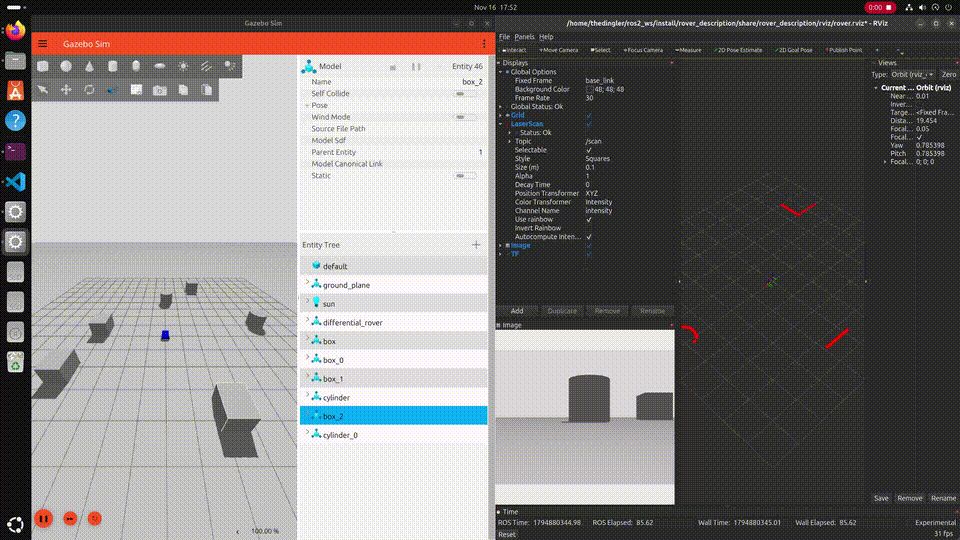
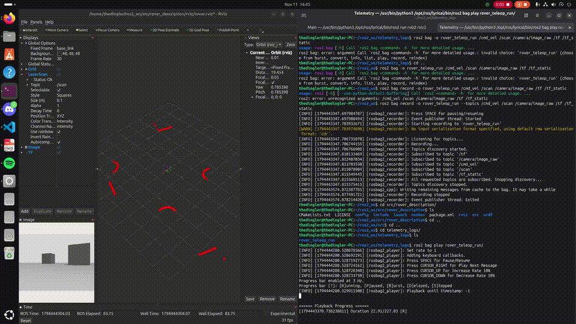
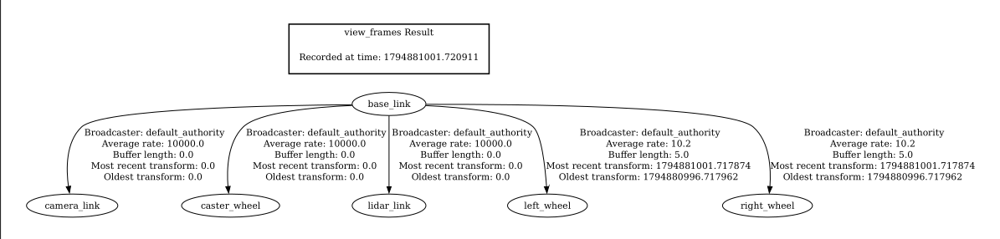

# ROS 2 Differential-Drive Rover Simulation & Robotics Foundations


## Overview
A simulated differential-drive mobile robot built in **ROS 2 Lyrical** and **Gazebo Sim**, featuring custom URDF/Xacro physics modeling, GPU-accelerated Lidar and RGB camera sensors, bidirectional ROS–Gazebo topic bridging, Xbox One gamepad teleoperation, and `ros2 bag` telemetry logging.

Alongside the flagship `rover_description` simulation, this workspace houses foundational C++ and Python packages covering core ROS 2 communication primitives (Topics, Actions, Custom Interfaces, and TF2 spatial transformations).



---

## Key Features & System Architecture
* **Modular URDF/Xacro Robot Description (`rover_description`):**
  * **Chassis & Kinematics:** `0.6m × 0.4m × 0.1m` rigid base (`2.0 kg`) paired with parameterized Xacro wheel macros (`0.1m` radius, `0.45m` track separation) and a zero-friction front spherical caster (`0.05m` radius).
  * **Physics & Actuation:** Custom 3D inertia matrices, surface friction coefficients (`mu1`, `mu2`), contact stiffness (`kp`), damping (`kd`), and Gazebo's `DiffDrive` system plugin (`gz-sim-diff-drive-system`).
  * **Simulated Sensors:** 360-degree GPU Lidar (`/scan`) and 640×480 RGB Camera (`/camera/image_raw`) powered by Gazebo's `Sensors` plugin (`ogre2` render engine) with explicit `<gz_frame_id>` TF alignment.
* **Single-Command System Bringup:** Master `bringup.launch.py` orchestrates `robot_state_publisher`, Gazebo Sim, `ros_gz_bridge`, RViz2, and gamepad teleoperation concurrently.
* **Telemetry Logging & Offline Analysis:** Configured `ros2 bag` recording pipelines capturing `/cmd_vel`, `/scan`, `/camera/image_raw`, `/tf`, and `/tf_static` for standalone RViz2 replay without active physics simulation.

### Workspace Package Structure
```text
ros2_ws/
├── docs/
│   └── media/                  # Simulation GIFs and TF tree graphs
└── src/
    ├── rover_description/      # URDF/Xacro model, Gazebo plugins, RViz configs, & launch files
    ├── cpp_tf2/                # Static & dynamic TF2 broadcasters and real-time listener nodes
    ├── custom_interfaces/      # Custom RobotStatus.msg and SetVelocity.srv definitions
    ├── cpp_actions/            # Asynchronous C++ Action Server & Client (Fibonacci implementation)
    ├── cpp_pub_sub/            # C++ Publisher & Subscriber nodes
    └── py_subpub/              # Python Publisher & Subscriber nodes
```

---

## Prerequisites & Dependencies
* **OS:** Ubuntu Linux
* **Middleware:** ROS 2 Lyrical
* **Build Tools:** `colcon`, `cmake`, `g++` (C++17)

Install required ROS 2 simulation, Xacro, and teleop packages:
```bash
sudo apt install -y \
  ros-lyrical-ros-gz \
  ros-lyrical-xacro \
  ros-lyrical-joy \
  ros-lyrical-teleop-twist-joy \
  ros-lyrical-teleop-twist-keyboard \
  ros-lyrical-tf2-tools
```

---

## Build Instructions
1. **Clone the repository into a workspace:**
   ```bash
   mkdir -p ~/ros2_ws/src
   cd ~/ros2_ws
   git clone [https://github.com/IzzyFunk/ros2_ws.git](https://github.com/IzzyFunk/ros2_ws.git) .
   ```
2. **Compile the workspace with Colcon:**
   ```bash
   colcon build
   source install/setup.bash
   ```

---

## Usage

### 1. Launch Full Rover Simulation (Gazebo + RViz2 + Teleop)
Ensure an Xbox One controller is connected (or launch keyboard teleop separately), then run the master bringup script:
```bash
ros2 launch rover_description bringup.launch.py
```
* **Controls:** Hold the configured deadman switch (right bumper) on the gamepad and use the thumbsticks to publish `geometry_msgs/msg/Twist` commands to `/cmd_vel`.

### 2. Record & Replay Telemetry (`ros2 bag`)
Record live control, sensor, and transform streams during a simulation run:
```bash
mkdir -p ~/ros2_ws/telemetry_logs && cd ~/ros2_ws/telemetry_logs
ros2 bag record -o rover_teleop_run --topics /cmd_vel /scan /camera/image_raw /tf /tf_static
```
To analyze the run offline without Gazebo running, launch standalone RViz2 and play back the SQLite3 database:
```bash
# Terminal 1: Launch RViz2 with saved layout
ros2 run rviz2 rviz2 -d ~/ros2_ws/src/rover_description/rviz/rover.rviz

# Terminal 2: Replay recorded telemetry
cd ~/ros2_ws/telemetry_logs
ros2 bag play rover_teleop_run
```

---

## Visualization & TF Tree
| Offline Telemetry Replay (`ros2 bag`) | TF2 Coordinate Frame Graph |
| :---: | :---: |
|  |  |